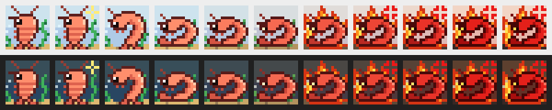

# Shrimple 🦐

A tiny pixel-art shrimp that lives in your Windows system tray, in its own
little patch of sea, and quietly reminds you to check your posture. No sounds, no pop-ups, no notifications:
just a shrimp.



- **Calm:** the shrimp stands up straight while the timer counts down.
- **Posture check due:** it slouches, then curls up into a ball.
- **Ignored:** after a minute it starts turning red, then glaring, and the
  seaweed behind it wilts. A few minutes later the seaweed bursts into
  flames and the water starts to boil orange. About ten minutes in, it's bright red, has an anger vein, and is
  hopping in place.
- **Click the shrimp** once you've sat up straight. It sparkles briefly and
  starts the countdown over.

Hover over the shrimp to see how long until the next check.

## Menu (right-click)

- **I sat up straight:** same as left-clicking the shrimp.
- **Remind me every:** 5, 10, 15, 20, 30 or 45 minutes, or 1 or 1½ hours
  (default 30 minutes). Choosing one restarts the countdown.
- **Pause reminders:** the shrimp stays calm until you unpause.
- **Start with Windows:** launch Shrimple when you sign in.
- **Quit**

## It won't nag an empty chair

The countdown restarts on its own when you've clearly stepped away: after 5
minutes with no keyboard or mouse input, when you unlock your PC, and when it
wakes from sleep.

## Building

Install [Rust](https://rustup.rs/), then on Windows:

```sh
cargo build --release
```

The app is `target\release\shrimple.exe`. Run it and look for the shrimp in
the tray. You may need to drag it out of the overflow area (`^`) so it's
always visible. Every push also builds the `.exe` on GitHub Actions, where you
can download it as the `shrimple` artifact.

To cross-compile from Linux, install `mingw-w64` and run
`rustup target add x86_64-pc-windows-gnu` and
`cargo build --release --target x86_64-pc-windows-gnu`.

Settings live in the registry under `HKCU\Software\Shrimple`. "Start with
Windows" uses the standard `HKCU\...\CurrentVersion\Run` entry.

## Hacking on the shrimp

- `src/sprite.rs`: the 16×16 pixel art, as ASCII, plus the calm and furious
  color palettes. The water, seabed and flames are drawn behind the shrimp.
- `src/shrimp.rs`: timing for when it curls up and how fast it gets angry
  (constants at the top).
- `src/tray.rs`: the Win32 tray icon, menu and timer.

`cargo run --example preview` renders every mood, on light and dark taskbars,
to `shrimp-preview.png` on any OS. `cargo test` runs the mood and sprite tests.
