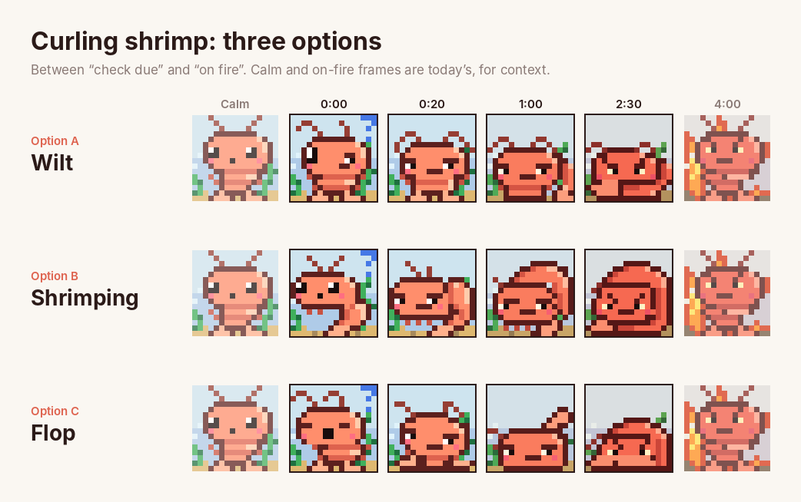
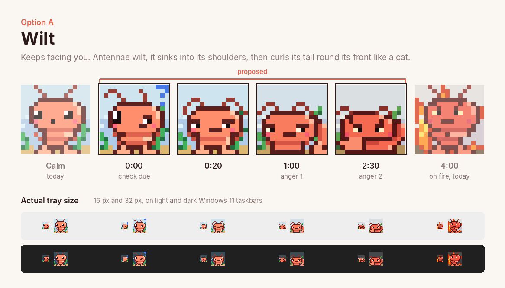
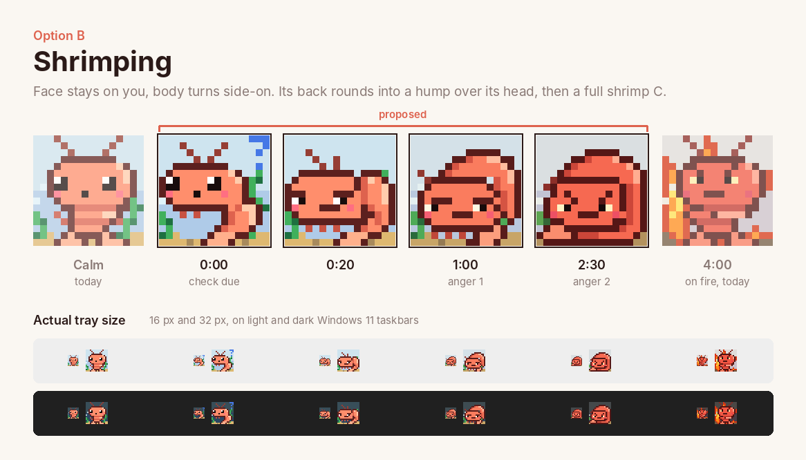
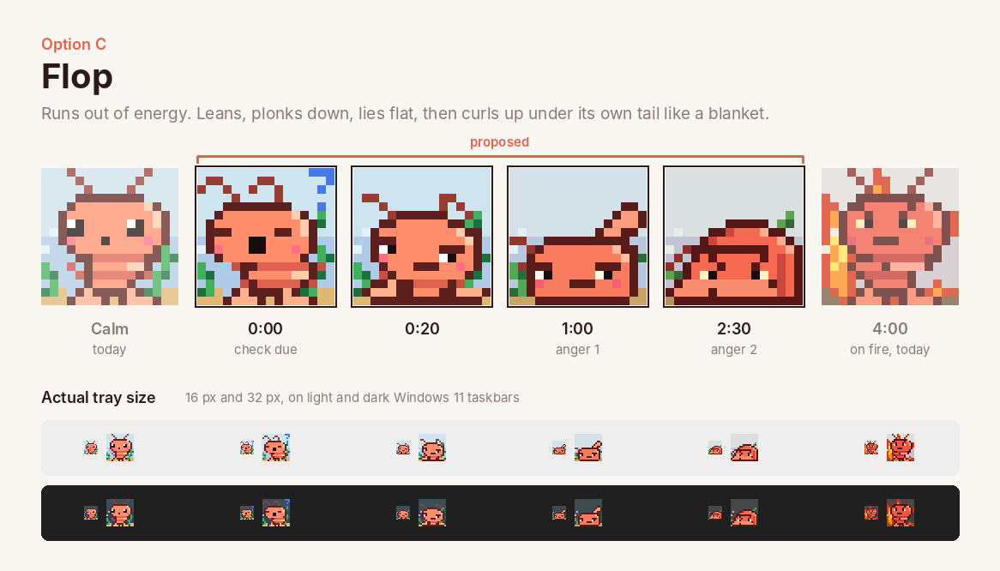

# Curling shrimp proposals

The chibi redraw dropped the slouch and curl frames. These are three ways to
bring the curl back for the frames between "check due" and "on fire", keeping
the chibi head and face. Every option has four frames, one for each existing
state before the flames start:

| Time overdue | Today | Anger tint | Corner stamp |
| --- | --- | --- | --- |
| 0:00 | `DOUBTFUL` | 0 | `?` |
| 0:20 | `SUSPICIOUS` | 0 | none |
| 1:00 | `SUSPICIOUS` (tinted) | 1 | none |
| 2:30 | `FUMING` | 2 | none |

Flames take over at 4:00 with the existing `FUMING` frame. The 1:00 frame is
the only new state: `compose()` would pick it when `anger == 1`.



The frames below use the legend from `src/sprite.rs`, so the chosen set can be
pasted in as is.


## Option A: Wilt



```rust
/// 0:00: One antenna wilts, sags a row, doubtful side-eye.
const A_SAG: [&str; ART_SIZE] = [
    "................",
    "..aa.....a......",
    ".a..a.....a.....",
    ".....a....a.....",
    "....oooooooo....",
    "...obbbbbbbbho..",
    "..owebbbbbbbbho.",
    "..owebbbbboobho.",
    "..oeebbbbbwebbo.",
    "..ombbbbboobmbo.",
    "...obbbbbbbbbo..",
    "...loossssssol..",
    "....obbbbbhho...",
    "....losssssol...",
    "....otooooto....",
    "...ottto.ottto..",
];
/// 0:20: Head sinks into its shoulders, both antennae flop, unimpressed.
const A_SLUMP: [&str; ART_SIZE] = [
    "................",
    "................",
    "................",
    "...aa......aa...",
    "..a..a....a..a..",
    ".a..oooooooo..a.",
    ".a.obbbbbbbbho.a",
    "..obbbbbbbbbbho.",
    "..ooobbbbbooobo.",
    "..owebbbbbwebbo.",
    "..ombbbooobbmbo.",
    "..loobbbbbbbool.",
    "...losssssshol..",
    "....obbbbbbho...",
    "....otooooto....",
    "...ottto.ottto..",
];
/// 1:00: Hunkered down, tail starting to curl round from behind.
const A_HUNKER: [&str; ART_SIZE] = [
    "................",
    "................",
    "................",
    "................",
    "..aa.....aa.....",
    ".a..a...a..a....",
    "a..oooooooo.a...",
    "..obbbbbbbbhoo..",
    ".obbbbbbbbbbhoo.",
    ".ooobbbbbooobosh",
    ".owebbbbbwebbosb",
    ".ombbbooobbmbosb",
    "..obbbbbbbbbo.sb",
    "..lossssssol.ohb",
    "...obbbbbbo.otto",
    "...oooooooo.ottt",
];
/// 2:30: Balled up, tail wrapped round its front, glaring over it.
const A_BALL: [&str; ART_SIZE] = [
    "................",
    "................",
    "................",
    "................",
    "................",
    ".aa.......aa....",
    "a..aoooooa..a...",
    "..oobbbbbbhoo...",
    ".obobbbbbbobhoo.",
    ".obboobbboobbosh",
    ".obbwebbbewbbosb",
    ".ombbbbbbbbbmosb",
    ".ootttooooooosbo",
    "otttttosssbbbbo.",
    ".ottttobbbbbho..",
    "..oooooooooooo..",
];
```

## Option B: Shrimping



```rust
/// 0:00: Tech neck: head pushed forward of its body.
const B_CRANE: [&str; ART_SIZE] = [
    "................",
    "...a.....a......",
    "....a...a.......",
    ".....a.a........",
    "..oooooooo......",
    ".obbbbbbbbho....",
    "owebbbbwebbho...",
    "oeebbbbeebbbo...",
    "ombbbebbbmbbo...",
    ".obbbbbbbbbboo..",
    "..oooooooobshho.",
    "...l.l...osbbho.",
    ".........osbbho.",
    "........osbbbo..",
    ".......otttoo...",
    "......ottto.....",
];
/// 0:20: Slumped: head drops forward, back rounds out behind it.
const B_SLUMP: [&str; ART_SIZE] = [
    "................",
    "................",
    "...a............",
    "....a..a........",
    ".....a.a........",
    "..oooooooo.ooo..",
    ".obbbbbbbboshbo.",
    "obbbbbbbbbosbbho",
    "ooobbbbooobsbbho",
    "owebbbbwebbsbbho",
    "ombbbooobmbosbbo",
    ".obbbbbbbbboosbo",
    "..oooooooooobsbo",
    "...l.l.l..osbbo.",
    "........otttoo..",
    ".......ottto....",
];
/// 1:00: Hunched: its back rises above its head, tail tucking under.
const B_HUNCH: [&str; ART_SIZE] = [
    "................",
    "................",
    "........ooooo...",
    "......oosbbhhoo.",
    ".....osbbbbbbho.",
    ".a..osbbbbbbbbho",
    "..aoooooooo.sbho",
    "..obbbbbbbbosbbo",
    ".obbbbbbbbbbosbo",
    ".obooobbbooobsbo",
    ".owebbbbbwebosbo",
    ".ombbbooobbmbobo",
    "..obbbbbbbbbo.o.",
    "...oooooooooto..",
    "...l.l.l.ottto..",
    "........ootto...",
];
/// 2:30: Curled: back arched right over, tail tucked under its chin, fuming.
const B_CURL: [&str; ART_SIZE] = [
    "................",
    "................",
    ".......ooooo....",
    ".....oosbbbhoo..",
    "....osbbbbbbbho.",
    "...osbbbbbbbbbho",
    "..aooooooooobbho",
    ".aobbbbbbbbbosbo",
    "..obobbbbbobosbo",
    ".obbbobbbobbosbo",
    ".obwebbbbewbosbo",
    ".ombbbooobbmbsbo",
    "..oobbbbbbboosbo",
    ".ottoooooooosbbo",
    "ottttosssbbbbbo.",
    ".ooooooooooooo..",
];
```

## Option C: Flop



```rust
/// 0:00: Leaning over with a big yawn, antennae drooping.
const C_YAWN: [&str; ART_SIZE] = [
    "................",
    ".aa....aa.......",
    "a..a..a..a......",
    "....a....a......",
    "...oooooooo.....",
    "..obbbbbbbbho...",
    ".obbbbbbbbbbho..",
    ".ooobbbbboobho..",
    ".obbbbeebbbbbo..",
    ".ombbbeebbbmbo..",
    "..obbbbbbbbbo...",
    "....loossssssol.",
    ".....obbbbbhho..",
    ".....losssssol..",
    "....otooooto....",
    "...ottto.ottto..",
];
/// 0:20: Plonked down on the sand, head lolling, tail splayed out front.
const C_SIT: [&str; ART_SIZE] = [
    "................",
    "................",
    "................",
    ".aa.......aa....",
    "...a......a.a...",
    "....aoooooo..a..",
    "...oobbbbbboo...",
    "..obbbbbbbbbhoo.",
    "..ooobbbbbbbbho.",
    "..owebbbbbooobo.",
    "..ombbbbbbwebbo.",
    "...obbbooobbmbo.",
    "...lobbbbbbbbo..",
    "..ootoossssol...",
    ".otttoobbboottto",
    "..ooooooooooooo.",
];
/// 1:00: Flat on its belly, chin on the sand, tail kicked up behind.
const C_LIE: [&str; ART_SIZE] = [
    "................",
    "................",
    "................",
    "................",
    ".............oo.",
    "............otto",
    "...........ottto",
    "..........ottoo.",
    "aa..oooooooooo..",
    "..aobbbbbbbbhoo.",
    "..obbbbbbbbbbho.",
    ".aooobbbbbooobo.",
    "..owebbbbbwebbo.",
    "..ombbbooobbmbo.",
    "..obbbbbbbbbbbo.",
    "...ooooooooooo..",
];
/// 2:30: Curled up on the sand, tail pulled over its mouth, glaring.
const C_BLANKET: [&str; ART_SIZE] = [
    "................",
    "................",
    "................",
    "................",
    "................",
    "................",
    ".......ooooo....",
    ".....oosbbbhoo..",
    "....osbbbbbbbho.",
    "..aooooooooobbho",
    ".a.obobbbbbobsbo",
    "a.obbbobbbobbsbo",
    "..obwebbbbewbsbo",
    ".ottttttttttosbo",
    "ottttotttttttsbo",
    ".ooooooooooooooo",
];
```
